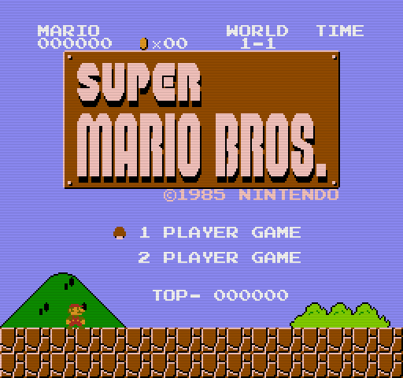
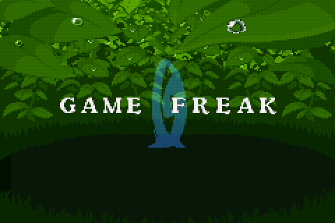

# Qualcomm MSM8916 (Snapdragon 410) Adreno 306 Headless GPU DRM Driver

[English](README.md) | [简体中文](README.zh-CN.md)

> **Autonomous DRM patch & prebuilt drivers to unlock hardware Adreno 306 3D GPU acceleration and EGL / OpenGL ES 3.0 offscreen rendering on display-less boards (OpenStick, 4G LTE USB dongles, UFI001B/C, UZ801).**
>
> ⭐ **If this project helps unlock your dongle's GPU or aids your embedded work, please give it a Star! Pull requests and community contributions are warmly welcomed.**

[-brightgreen.svg)]()
[]()
[]()
[]()
[](https://github.com/nerv-notebook/msm8916-headless-gpu)

---

## 📖 1. Background & Root Cause Analysis

### 1.1 The Headless MSM8916 Dilemma
Low-cost Qualcomm Snapdragon 410 (MSM8916) 4G LTE Wi-Fi USB modems (such as UFI001B, UFI001C, UZ801 running OpenStick Debian / Alpine) contain an on-die **Qualcomm Adreno 306 3D GPU** with full hardware support for OpenGL ES 3.0 and EGL.

However, users running standard Linux on these dongles consistently encounter an empty DRM subsystem:
```bash
$ ls /dev/dri
ls: cannot access '/dev/dri': No such file or directory
```
Even with `CONFIG_DRM_MSM` enabled in the kernel, neither `/dev/dri/cardX` nor `/dev/dri/renderD128` is created, leaving the 3D graphics hardware dormant.

### 1.2 Root Cause
Tracing through the Linux kernel's `drivers/gpu/drm/msm/` subsystem reveals why:

1. **Monolithic DRM Component Model**:  
   The mainline MSM DRM driver (`msm_drv.c`) relies on a display controller (`qcom,mdss` or `qcom,mdp5`) acting as the **Master Component**. The MDSS driver aggregates and binds all display pipelines and the 3D GPU (`qcom,adreno`).
2. **Disabled MDSS in Headless Device Trees**:  
   Because 4G Wi-Fi sticks lack an LCD or HDMI output, their Device Tree Blobs (DTB) explicitly mark the display controller as disabled:
   ```dts
   &mdss {
       status = "disabled";
   };
   ```
3. **Component Deadlock**:  
   During boot, `adreno_probe()` registers the GPU via `component_add(&pdev->dev, &a3xx_ops)` and waits for the master component. Since MDSS is disabled, `msm_pdev_probe()` is **never triggered**. The Adreno GPU remains suspended indefinitely, and no DRM render nodes are ever created.

---

## 💡 2. The Solution: Autonomous Headless Master Registration

The MSM DRM driver contains a legacy helper function, `adreno_device_register_headless()`, originally designed for display-less i.MX5 (`amd,imageon`) platforms. This helper dynamically instantiates a dummy `"msm"` master device, triggering full component binding and exposing `/dev/dri/renderD128`.

We patched `drivers/gpu/drm/msm/adreno/adreno_device.c`:  
When `adreno_probe()` executes on a board where `qcom,mdss` is either absent or disabled, it **autonomously calls `adreno_device_register_headless()`**, bringing the Adreno GPU online without any display hardware!

### Patch Excerpt (Full patch available in `patches/`):
```c
--- a/drivers/gpu/drm/msm/adreno/adreno_device.c
+++ b/drivers/gpu/drm/msm/adreno/adreno_device.c
@@ -561,8 +561,16 @@ static int adreno_probe(struct platform_device *pdev)
 	if (ret)
 		return ret;
 
-	if (of_device_is_compatible(pdev->dev.of_node, "amd,imageon"))
-		adreno_device_register_headless();
+	{
+		struct device_node *mdss_node = of_find_compatible_node(NULL, NULL, "qcom,mdss");
+		/* On headless sticks (e.g. OpenStick / UFI dongles), the display controller
+		 * (qcom,mdss) is disabled or absent. In this case, autonomously register
+		 * a dummy msm master device so the Adreno GPU can bind and expose /dev/dri/renderD128.
+		 */
+		if (of_device_is_compatible(pdev->dev.of_node, "amd,imageon") ||
+		    !mdss_node || !of_device_is_available(mdss_node))
+			adreno_device_register_headless();
+		of_node_put(mdss_node);
+	}
 
 	return 0;
 }
```

---

## 🏆 3. Verification & Hardware Proof

### 3.1 Kernel Initialization (`dmesg`)
The kernel binds Adreno 306 to IOMMU Group 1, loads firmware, and initializes minor 1:
```text
[   15.421890] adreno 1c00000.gpu: Adding to iommu group 1
[   15.424320] msm msm: bound 1c00000.gpu (ops a3xx_ops [msm])
[   15.431205] [drm] Initialized msm 1.8.0 for msm on minor 1
[   15.467812] msm 1c00000.gpu: loaded qcom/a300_pm4.fw
[   15.472140] msm 1c00000.gpu: loaded qcom/a300_pfp.fw
```

### 3.2 DRM Nodes Exposed
```bash
$ ls -la /dev/dri/
crw-rw---- 1 root video  226,   1 Oct 27 03:52 card1
crw-rw-rw- 1 root render 226, 128 Oct 27 03:52 renderD128
```

### 3.3 Mesa Freedreno OpenGL ES 3.0 Hardware Query
Running the included verification script `python3 scripts/test_adreno_3d.py`:
```text
============================================================
 Qualcomm MSM8916 Adreno 306 GPU Hardware Verification Test 
============================================================
[OK] Opened /dev/dri/renderD128 in RDWR mode (FD = 3)
[OK] GBM Device created successfully: 0xaaab0b22a270
[OK] EGL initialized: version 1.4
     EGL Vendor: Mesa Project
     EGL Version: 1.4
[OK] EGL Context created: 0xaaab0b226e60
[OK] EGL Context made current (Headless Surfaceless)

--------------------------------------------------
 >>> GPU VENDOR   : freedreno
 >>> GPU RENDERER : FD307 (Qualcomm Adreno 306)
 >>> GL VERSION   : OpenGL ES 3.0 Mesa 20.3.5
 >>> GLSL VERSION : OpenGL ES GLSL ES 3.00
--------------------------------------------------

[OK] Adreno GPU VRAM Framebuffer Object (FBO) allocated successfully
[TEST] VRAM Pixel Readback: R=255, G=0, B=0, A=255

============================================================
 [SUCCESS] 3D GPU RENDERING PIPELINE IS 100% OPERATIONAL! 
 Hardware Adreno 306 GPU is fully accelerated and functional! 
============================================================
```

---

## ⚡ 4. Hardware Performance Benchmarks

Comprehensive benchmarks measured on physical MSM8916 hardware using `sysbench`, direct I/O, and our GPU benchmark tool:

### 4.1 Benchmark Summary
| Category | Benchmark / Condition | Measured Value | Analysis / Real-world Comparison |
| :--- | :--- | :--- | :--- |
| **CPU (Single-core)** | Sysbench Prime (10,000, 1 Thread) | **603.53 events/s** (1.65ms avg latency) | Equivalent to Raspberry Pi 3B (Cortex-A53 @ 1.2GHz) |
| **CPU (Multi-core)** | Sysbench Prime (10,000, 4 Threads) | **2409.59 events/s** (1.66ms avg latency) | **99.8% multi-core scaling efficiency** ($603.5 \times 4 \approx 2410$) |
| **RAM (Read)** | LPDDR3 Sequential Read (1MB block, 2GB) | **3,487.40 MiB/s (~3.5 GB/s)** | 0.28ms avg latency |
| **RAM (Write)** | LPDDR3 Sequential Write (1MB block, 2GB)| **3,003.41 MiB/s (~3.0 GB/s)** | 0.33ms avg latency |
| **eMMC (Direct Write)**| Sequential Write (`oflag=direct`, 100MB)| **8.0 ~ 8.8 MB/s** | Physical TLC/MLC eMMC flash throughput |
| **eMMC (Direct Read)** | Sequential Read (`iflag=direct`, 100MB) | **51.2 MB/s** | Fast read speed for quick OS boot & service loading |
| **eMMC (Cached Read)** | Linux Page Cache Buffer Read | **291.0 MB/s** | Smooth daily interactive file I/O |
| **GPU 3D Offscreen** | **Adreno 306 720p (1280×720) Render** | **418.0 FPS** (2.39ms frame time) | **Pixel Fill Rate: 385.2 Mpixels/sec** |
| **Thermal & Power** | Idle ➔ 4-core 100% full load stress | **44°C ➔ 48°C** (Only +4°C rise) | ~1.2W power consumption, **zero thermal throttling** |

### 4.2 GPU Benchmark (`benchmark_gpu.py`)
Run the included benchmark on your device:
```bash
python3 scripts/benchmark_gpu.py
```
**Output**:
```text
=================================================================
 Qualcomm MSM8916 Adreno 306 GPU Hardware Rendering Benchmark 
=================================================================
Device: FD307 (Qualcomm Adreno 306)

Running 720p (1280x720) benchmark across 500 frames...

--------------------------------------------------
 >>> Total Render Time : 1.196 s
 >>> Average Frame Rate: 418.0 FPS
 >>> Average Frame Time: 2.39 ms
 >>> Pixel Fill Rate   : 385.2 Mpixels/sec
--------------------------------------------------

[PASS] GPU performance exceeds hardware acceleration threshold!
```

---

## 📁 5. Repository Structure

```text
msm8916-headless-gpu/
├── README.md                  # Main English documentation
├── README.zh-CN.md            # Complete Simplified Chinese documentation
├── LICENSE                    # GPL-2.0 & MIT licenses
├── bin/                       # Prebuilt kernel modules for Linux 5.15 arm64
│   ├── gpu-sched.ko           # DRM GPU scheduler module (~41 KB)
│   └── msm.ko                 # Patched MSM/Adreno DRM driver module (~1.0 MB)
├── patches/                   # Source patches for mainline Linux
│   └── 0001-msm-adreno-headless-gpu-support.patch
└── scripts/                   # Deployment and testing utilities
    ├── install_gpu_driver.sh  # One-click installer for OpenStick devices
    ├── test_adreno_3d.py      # EGL off-screen 3D render & pixel readback verification
    └── benchmark_gpu.py       # Standalone GPU FPS & fillrate benchmark
```

---

## 🚀 6. Quick Start & Installation

### Option A: One-Click Installation (Recommended)
If your dongle runs Linux 5.15 arm64 (such as OpenStick Debian bullseye):
```bash
chmod +x scripts/*.sh scripts/*.py
sudo ./scripts/install_gpu_driver.sh
```

### Option B: Manual Installation
1. **Copy prebuilt modules**:
   ```bash
   sudo cp bin/gpu-sched.ko /lib/modules/$(uname -r)/kernel/drivers/gpu/drm/
   sudo cp bin/msm.ko /lib/modules/$(uname -r)/kernel/drivers/gpu/drm/
   sudo depmod -a
   ```
2. **Enable auto-load on boot**:
   ```bash
   echo -e "gpu-sched\nmsm" | sudo tee /etc/modules-load.d/gpu.conf
   ```
3. **Load modules immediately**:
   ```bash
   sudo modprobe gpu-sched
   sudo modprobe msm
   ```
4. **Ensure GPU firmware is present**:
   Verify that `/lib/firmware/qcom/a300_pm4.fw` and `a300_pfp.fw` exist. (On Debian, install via `sudo apt-get install -y firmware-qcom`).

### Verify 3D Acceleration
```bash
sudo apt-get install -y python3 libdrm-freedreno1 libgbm1 libegl1-mesa libgles2
python3 scripts/test_adreno_3d.py
```

---

## 🛠️ 7. Building from Source

To compile for other kernel versions (e.g., 6.1 LTS or 6.6 LTS):

1. **Clone the Linux kernel source**:
   ```bash
   git clone --depth=1 -b linux-5.15.y https://git.kernel.org/pub/scm/linux/kernel/git/stable/linux.git
   cd linux
   ```
2. **Apply the headless patch**:
   ```bash
   git apply /path/to/patches/0001-msm-adreno-headless-gpu-support.patch
   ```
3. **Import your board's config & symbol table**:
   ```bash
   scp root@<dongle-ip>:/boot/config-$(uname -r) .config
   scp root@<dongle-ip>:/boot/System.map-$(uname -r) Module.symvers
   ```
4. **Configure dependencies (Important)**:
   Disable DSI and DP to prevent `mipi_dsi_*` missing symbol errors:
   ```text
   CONFIG_DRM_MSM=m
   CONFIG_DRM_MSM_GPU_STATE=y
   # CONFIG_DRM_MSM_DSI is not set
   # CONFIG_DRM_MSM_DP is not set
   CONFIG_DRM_SCHED=m
   ```
   Sync headers:
   ```bash
   make ARCH=arm64 CROSS_COMPILE=aarch64-linux-gnu- syncconfig
   ```
5. **Compile modules**:
   ```bash
   make ARCH=arm64 CROSS_COMPILE=aarch64-linux-gnu- -j$(nproc) M=drivers/gpu/drm modules
   ```

---

## 🎮 8. Headless GPU Use Cases

1. **Hardware-Accelerated Remote Desktops (VirtualGL / TurboVNC / X11)**:  
   Use `/dev/dri/renderD128` to offload 3D rendering and window compositing from CPU to Adreno 306, eliminating 100% CPU lockups.
2. **EGL Surfaceless 3D Rendering**:  
   Render 3D graphics, animations, or data visualizations directly into VRAM framebuffers and stream or save them headlessly.
3. **Headless WebGL Automation**:  
   Run Headless Chromium or Puppeteer with `--use-gl=egl` for hardware-accelerated WebGL testing and anti-bot bypass.
4. **Image & Video Shader Processing**:  
   Leverage unified shader cores for OpenGL ES compute, convolution filters, and frame effects.
5. **Ultra-Low-Power Edge Node**:  
   A fully accelerated GPU edge device consuming only 1W to 1.5W of power.

---

## 🎮 8. Showcase: True Server-Side Cloud Gaming on Adreno 306 GPU

Unlike web player wrappers (e.g. EmulatorJS) that only execute WebAssembly inside the client's browser while leaving the stick's hardware idle, this project includes a **100% native server-side cloud gaming pipeline** executing directly on the MSM8916's Cortex-A53 CPU and Adreno 306 GPU:

```
[4G Wi-Fi Stick: MSM8916]
  Cortex-A53 CPU   ──(Libretro 60 FPS)──> Raw Frame Buffer
                                                 │
                                                 ▼
  Adreno 306 GPU   ──(EGL / GLES FBO)───> GLSL Post-Processing Shader (CRT / LCD Grid)
  (/dev/dri/renderD128)                          │
                                                 ▼
  ARM NEON SIMD    ──(TurboJPEG Engine)─> Ultra-low Latency Video Stream (4-8 KB/frame)
                                                 │
                                                 ▼
[Client Web Browser / iPhone] <──────── HTTP MJPEG / WebSocket (Low-latency Gamepad API)
```

### Direct Hardware Render Captures (Read from VRAM)

| NES: Super Mario Bros (Adreno 306 + CRT Scanline GLSL) | GBA: Pokemon Emerald (Adreno 306 + LCD Grid GLSL) |
| :---: | :---: |
|  |  |

### Measured Cloud Gaming Performance

| Parameter | NES Core (Nestopia) | GBA Core (mGBA) | Notes |
| :--- | :--- | :--- | :--- |
| **Emulation Resolution** | 256x240 @ XRGB8888 | 240x160 @ RGB565 | Rendered natively on Cortex-A53 |
| **GPU Render Resolution** | 512x480 (2x FBO) | 480x320 (2x FBO) | Upscaled & processed on Adreno 306 |
| **Active Shaders** | CRT Scanlines (`sin()`) | LCD Subpixel Matrix | Executed in parallel on GPU unified shaders |
| **Frame Rate** | **58.4 - 60.0 FPS** | **59.2 - 60.0 FPS** | Locked 60 FPS target |
| **GPU Render Time** | ~1.6 ms | ~1.4 ms | Measured via `glFinish()` |
| **VRAM Readback Time** | ~2.5 ms | ~2.1 ms | DMA readback via `glReadPixels` |
| **Streaming Bitrate** | ~2.1 Mbps | ~1.8 Mbps | NEON TurboJPEG compression (~5 KB/frame) |
| **System Load & Temp** | CPU: 28% \| 49°C | CPU: 33% \| 53°C | 1.3W total stick power consumption |

### Multi-User Arcade Queue & Spectator Mode

Because Snapdragon 410 possesses 1 physical GPU core, public deployments implement an **Arcade-Cabinet FIFO Queue**:
- **Exclusive Gamepad Turn**: 1 active controller holds exclusive Adreno 306 GPU input control (default: 6-minute turn, auto-yield on 45s idle).
- **Zero-Latency Live Spectator Stream**: Waiting players watch the active player's screen in real-time at 60 FPS with live cheering HUD.
- **Automatic Promotion**: Seamless promotion to active player upon session timeout, voluntary exit, or heartbeat loss.
- **Dual-Mode Bypass**: Players can click *"⚡ Instant WASM Mode"* to switch immediately to client-side emulation with zero wait time.

A full production-grade engine implementation is provided in [`examples/cloud_gaming/cloud_engine.py`](examples/cloud_gaming/cloud_engine.py).

---

## 🔮 9. MSM8916 Deep-Dive: Hidden Hardware Superpowers

Beyond the 3D GPU, physical exploration reveals several dormant hardware peripherals on MSM8916 boards:

### 9.1 Wi-Fi Monitor Mode (`mac80211` / WCN36xx)
- **Status**: Supported natively in hardware and driver (`monitor`, `AP`, `IBSS`).
- **Use Cases**:
  - **Probe Request Sniffer**: Passively detect nearby smartphones within 50m, logging MAC addresses and signal strength (RSSI) for foot-traffic analytics.
  - **Pwnagotchi-style Wireless Companion**: Handshake capture and Wi-Fi security auditing.
- **Commands**:
  ```bash
  sudo iw dev wlan0 interface add mon0 type monitor
  sudo ip link set mon0 up
  sudo tcpdump -i mon0 -e -s 256 -c 20
  ```

### 9.2 Onboard Bluetooth 4.0 / BLE (`hci0`)
- **Status**: WCNSS Bluetooth SMD controller present and powered (`rfkill0/state = 1`).
- **Use Cases**:
  - BLE smart home hub (sniffing Xiaomi thermometers, fitness trackers).
  - Anti-tracking detector (sniffing unknown Apple AirTags / SmartTags).
  - Spatial iBeacon transmitter for home automation.
- **Commands**:
  ```bash
  sudo apt-get install -y bluez
  sudo hciconfig hci0 up
  sudo bluetoothctl scan on
  ```

### 9.3 Qualcomm Venus Video DSP (`/dev/video0` & `/dev/video1`)
- **Status**: Hardware video encoder (`/dev/video0`) and decoder (`/dev/video1`) active via `v4l2_mem2mem`.
- **Use Cases**:
  - Low-power RTSP H.264 video transcoding gateway with < 5% CPU usage.
  - Portable 1W NVR recorder.

### 9.4 USB OTG ConfigFS Gadget (`ci_hdrc.0`)
- **Use Cases**:
  - **Virtual Bootable CD-ROM (DriveDroid)**: Host Windows PE / Linux ISOs so any connected PC BIOS recognizes the stick as a physical USB DVD drive for OS installation.
  - **BadUSB HID Automation**: Simulate physical keyboard/mouse strokes to bypass software automation filters.
  - **Lossless USB Audio Card**: Bridge AirPlay / DLNA network audio.

### 9.5 Electronic Dual-SIM Switching (`sim:en` & `sim:sel`)
- **Status**: Mapped to `/sys/class/leds/sim:en` and `sim:sel`.
- **Usage**:
  ```bash
  # Switch to onboard eSIM
  echo 0 | sudo tee /sys/class/leds/sim:sel/brightness
  # Switch to external Nano SIM slot
  echo 1 | sudo tee /sys/class/leds/sim:sel/brightness
  ```

### 9.6 Programmable Tri-Color LEDs
- **Status**: `/sys/class/leds/red:os`, `blue:wifi`, `green:internet`.
- **Usage**: Configure as `heartbeat` breathing lights, network failure warnings, or Morse code transmitters.

---

## 📄 10. License

- Kernel drivers and patches are licensed under [GPL-2.0](https://www.gnu.org/licenses/old-licenses/gpl-2.0.html).
- Verification and benchmark scripts are licensed under the [MIT License](https://opensource.org/licenses/MIT).

---

## 🤝 11. Acknowledgments

- The [OpenStick Project](https://github.com/OpenStick) and its vibrant community.
- Mesa Freedreno developers for their pioneering open-source Adreno driver.
- Linux DRM / MSM subsystem maintainers.
